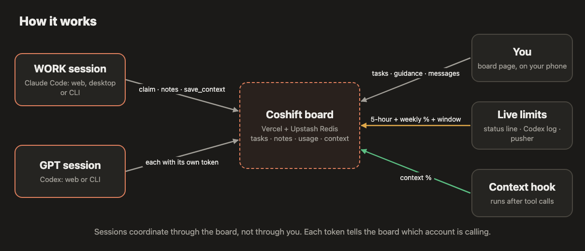

# Coshift

**Claude Code and Codex accounts, one shared board. They split your work into tasks, never edit the same files, hand over when one hits its limit, and restart from a saved summary instead of compacting.**

[](https://www.npmjs.com/package/coshift)
[](https://github.com/pgamerx/homebrew-tap)
[](https://github.com/pgamerx/coshift/actions/workflows/test.yml)

[](https://github.com/pgamerx/coshift/blob/main/LICENSE)


```bash
npx coshift demo     # the board with example data, nothing to set up
```

## The problem

You're halfway through a task when your 5-hour limit runs out. You ask for a handover note, switch to your other account (or from Claude to Codex), paste it in and hope nothing got lost. An hour later the context fills up and compaction throws away the details you needed.

Coshift turns that into a shift change: whoever comes on picks up exactly where the last one stopped, without you in the middle. Pay for a Claude plan and a ChatGPT plan and use both limits on one project.

## What it does

- **One board per project.** Every repo can have its own board; sessions use the right one automatically. Your account limits are shared across all of them.
- **No double work.** Sessions claim tasks one at a time. Tasks list the files they edit, and two sessions never edit the same files at once. Tasks can wait for other tasks.
- **Handovers at your limits.** Near the stop line (85% of the 5-hour limit or 90% weekly, both adjustable) a session finishes its small step, writes a handover and releases the task. Another account carries on from the notes.
- **Restarts instead of compaction.** At 70% context a session saves a full summary. The next session resumes from it with a two-line prompt.
- **Claude Code and Codex together.** Any mix of Claude and ChatGPT accounts. `coshift run` starts whichever has the most limit left; Codex limits come straight from its own logs, no setup.
- **On the web too.** Claude Code on claude.ai/code and Codex on chatgpt.com/codex join the same board as your desktop and CLI sessions, on the same repo.
- **One set of instructions, a lead and roles.** Write the project's instructions once on the board; every session sees them, Claude or Codex. Pick an orchestrator per project, give each account a role (*backend*, *reviewer*), and let accounts hand tasks to each other. Nobody touches another's files.
- **Questions reach you.** A session stuck on a decision asks on the board, and you get a phone alert if you want one. Your answer goes straight back to that session.
- **You see it working.** Every account shows its sessions and their last action, and flags one that holds a task but has gone quiet. On a Mac, the menu bar warns you if the desktop app is signed in as the wrong account.
- **You steer from anywhere.** The board works on your phone, in light and dark. A menu bar app (macOS) opens on a panel with every account's limits and activity; Windows and Linux get a tray icon.


## Get started

```bash
npm install -g coshift          # or: brew install pgamerx/tap/coshift
coshift setup
```

Setup takes about three minutes and explains each step: where the board lives (your own free Vercel project, or just this computer), your account names, a board for the repo you're in, connecting Claude Code on this computer and, if you use claude.ai/code, each account's cloud variables one at a time. Anything you skip shows up later as a checklist on the board page.

Then sign in each account once and start working:

```bash
coshift login WORK              # each account gets its own Claude Code profile
coshift login GPT --codex       # a ChatGPT account for Codex
coshift login GEM --antigravity # Antigravity (one Google account per computer)
coshift run                     # the account with the most limit left (Claude Code or Codex)
```

Tell the first session: *Use the Coshift board: split [your goal] into tasks, then claim one.* Start more sessions on your other accounts with *Use the Coshift board and claim the next task*, and they pick up the rest.

## How it works



The board is the only thing the sessions share. Claude Code and Codex sessions on your computer use it as an MCP server; cloud sessions on claude.ai/code reach it over HTTPS with their own token. Each account signs in through its own Claude Code profile, so Coshift never sees a password or token. Live limits come from Claude Code's own status line and Codex's own session log, and a small hook in your repo reports how full each cloud session's context is.

A session works out its project from its git repo: a repo with its own board uses it, and anything else uses the main board.

**[Read the full guide →](https://github.com/pgamerx/coshift/blob/main/docs/GUIDE.md)** for projects, cloud sessions, the context hook, every command and tool, settings, trays and security.

## FAQ

**Is running several accounts allowed?** Check [Anthropic's](https://www.anthropic.com/legal/consumer-terms) and [OpenAI's](https://openai.com/policies/row-terms-of-use/) terms for your plans. Coshift doesn't change any limits; it coordinates sessions you already run.

**Does it work on the web?** Yes. Claude Code on claude.ai/code and Codex on chatgpt.com/codex use the same board as your desktop and CLI sessions, on the same repo. Run `coshift env NAME` for each account's settings, and `coshift agents` once per repo.

**New computer?** Run `coshift setup` and pick *Restore from my Vercel board*. Sign in to the same Vercel account, choose your existing project, and Coshift pulls back your accounts and tokens. Tasks, projects and settings never left the board. Then run `coshift login NAME` once per account, because sign-ins stay on each machine.

**Do I need Vercel?** No. "This computer only" needs no account; you just can't open the board from your phone or use it from cloud sessions. With a Vercel board, Coshift deploys through the Vercel CLI, so it must be signed in to the account that owns the board (`vercel login`); `coshift doctor` checks it.

**Windows and Linux?** Yes: the board, the CLI, accounts and live limits work on all three. Only the desktop-app switcher in `mac/` is macOS-only.

**How do I update?** `coshift update`. It upgrades Coshift and redeploys your Vercel board. Coshift also tells you once a day when there's a new version; `coshift update --auto on` installs them by itself.

**I set Coshift up before 0.3. Do I have to change anything?** No. Your board becomes the main board, and boards from before the rename keep their `TEAM_BOARD_*` variable names. Run `coshift deploy` after upgrading.

---

MIT licensed. Formerly called Baton.
