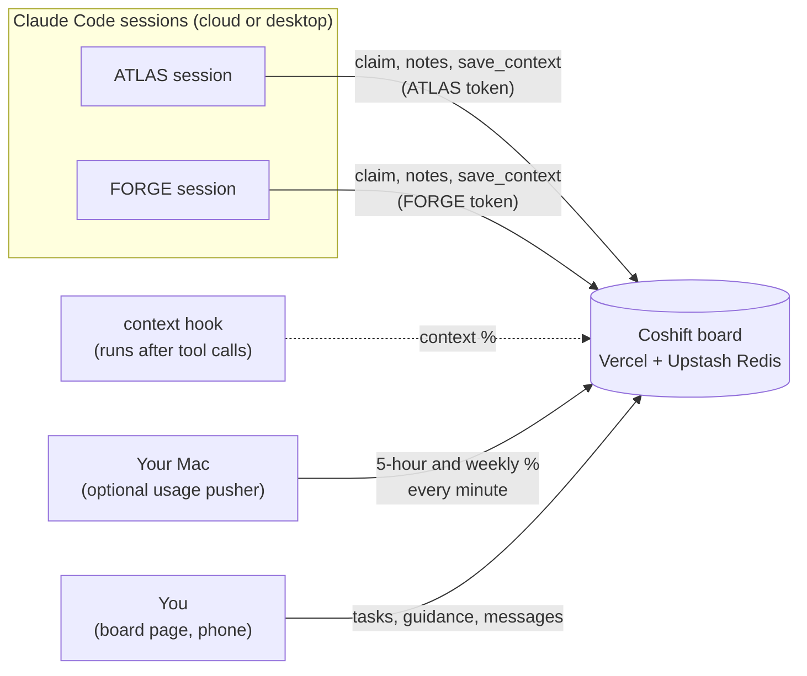
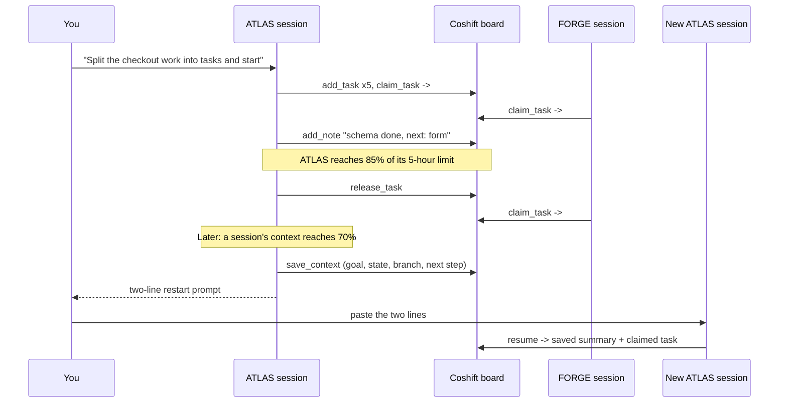

# Coshift

**Run several Claude Code accounts on one project at the same time, and let them hand work to each other instead of to you.**

<sub>Formerly called Baton.</sub>

<p align="center">
  
</p>

Coshift is a small shared task board that your Claude Code sessions use themselves. Each session claims its own task, leaves progress notes, and watches its account's usage and its own context window. When an account gets close to its limit, it hands its task over with a full note and the other account carries on. When a session's context fills up, it saves a summary to the board and gives you a two-line prompt for a fresh session that picks up exactly where it stopped. No copy-pasted handover documents, no paying for compaction.

[](../../actions/workflows/test.yml)


<p align="center">
  
  &nbsp;
  
  
</p>

<p align="center"><sub>The board page (demo data). It's built for checking from your phone.</sub></p>

---

## What it does

- **Splits the work.** Sessions take tasks from a shared queue with `claim_task`. Two accounts can never claim the same task, even at the same moment.
- **Watches both limits.** Each account's 5-hour and weekly usage is on the board. At 85% (5-hour) or 90% (weekly) an account stops taking work and hands its task over.
- **Watches the context window.** A hook reports how full each session's context is. At 70% the session finishes its current task, saves a summary to the board, and gives you a two-line restart prompt. The new session runs `board resume` and continues from that account's own summary.
- **Hands over cleanly.** Every task keeps its notes: what's done, what's next, files, branch. Whoever picks it up next gets all of it.
- **Lets you steer from your phone.** Add tasks, write standing guidance ("use pnpm", "don't touch payments") for both accounts or one, or send a one-off message that the session receives on its next board action.
- **Works in the cloud.** Cloud sessions on claude.ai/code use it over HTTPS with a per-account token. Desktop sessions can use it too, as an MCP server.

## How it works



A typical day, with two accounts:



The account names are yours to pick (`ATLAS` and `FORGE` here). The board identifies each session by its token, so the restart prompt is the same for every account.

## Install

```bash
npx coshift demo                    # try it first: the page with made-up data, at http://127.0.0.1:7788
npm install -g coshift              # or install it
brew install pgamerx/tap/coshift    # or with Homebrew
```

[](https://www.npmjs.com/package/coshift)

Needs Node 18+ and Python 3.9+ (the board is Python with no dependencies). Run `coshift help` for every command.

## Setup

You need: a [Vercel](https://vercel.com) account (the free plan is fine), the [Vercel CLI](https://vercel.com/docs/cli) (`npm i -g vercel`), and two or more Claude Code accounts or sessions.

> **Is running more than one account allowed?** Check [Anthropic's terms](https://www.anthropic.com/legal/consumer-terms) for your plan. Coshift doesn't change any limits. It only coordinates the sessions you already run.

**1. Deploy the board**

```bash
coshift setup
```

It walks you through four steps: creates a Vercel project for your board, adds free Upstash Redis storage (accept its terms when asked), asks for your account names and creates a token for each, then deploys. Everything you need next is written to `~/.coshift/cloud-setup.txt` (readable only by you). Running it again keeps your tokens; after upgrading Coshift, `coshift deploy` updates your board.

<details><summary>From a clone instead of npm</summary>

```bash
git clone https://github.com/pgamerx/coshift && cd coshift
vercel link && vercel integration add upstash/upstash-kv
python3 scripts/setup.py && vercel deploy --prod
```
</details>

**2. Connect each account's cloud environment**

In [claude.ai/code](https://claude.ai/code), open each account's environment settings:

- **Environment variables:** `COSHIFT_URL` and that account's `COSHIFT_TOKEN`. Copy both from `cat ~/.coshift/cloud-setup.txt`.
- **Network access:** allow your board's host (for example `my-coshift.vercel.app`).

**3. Install the context hook in your project (once)**

Give one session this prompt:

> Install the Coshift context hook in this repo. Fetch `$COSHIFT_URL/api/hook` with the header `Authorization: Bearer $COSHIFT_TOKEN` and follow its install steps: save the script as `.claude/hooks/board-context.sh` and merge the hook into `.claude/settings.json`. Commit both and push.

Or from your own machine: `mkdir -p .claude/hooks && coshift hook > .claude/hooks/board-context.sh` (then add the same `settings.json` entry, which `/api/hook` shows).

The hook does nothing unless `COSHIFT_URL` and `COSHIFT_TOKEN` are set, so it's harmless for anyone else working in the repo.

**4. Start working**

First session (the lead):

> Use the Coshift board. Run `curl -sS "$COSHIFT_URL/api/help" -H "Authorization: Bearer $COSHIFT_TOKEN"` and follow it. Split this goal into independent tasks with add_task, then claim one and start: [your goal]

Every other session, and every restart:

```
Run: curl -sS "$COSHIFT_URL/api/help" -H "Authorization: Bearer $COSHIFT_TOKEN" and follow it.
Start with board resume and continue from your saved context.
```

Open your board's URL on your phone. It asks once for the admin key from `cloud-setup.txt`.

### Optional: live usage from your Mac

Cloud sessions can't read their own plan usage, so a Mac can send it to the board every minute. `setup.py` detects the accounts signed in on your Mac, from the Claude desktop app and from the Claude Usage menu bar app if you use it, and asks which is which. Then:

```bash
cp ~/.coshift/local.coshift.push-usage.plist ~/Library/LaunchAgents/
launchctl bootstrap gui/$(id -u) ~/Library/LaunchAgents/local.coshift.push-usage.plist
```

Without it everything still works. Sessions get a "usage unknown" warning instead of live limits.

### Optional: desktop sessions

```bash
claude mcp add --scope user coshift -- coshift serve
```

Desktop sessions then get the board as tools (`claim_task`, `resume`, ...) and report their own usage and context through the desktop app's usage tool.

## The board's tools

| Tool | What it does |
|---|---|
| `resume` | Start of a session: this account's last saved context summary, its claimed tasks with notes, guidance. |
| `board_status` | Both accounts' usage, every session's context, and all tasks. |
| `claim_task` | Your unfinished task first, else the next open one (or `{"id": N}`). Refuses near a limit. |
| `add_task` | Add a task. `done_summary` records work already finished. |
| `add_note` | Progress note on a task: done so far, next step, files, branch. |
| `complete_task` / `release_task` | Finish a task, or give it back with a full handover. |
| `report_usage` / `report_context` | Usage and context numbers (the Mac pusher and the hook send these for you). |
| `save_context` | Save a summary for this account's next session. Too-short summaries are refused. |

From a cloud session: `curl -sS "$COSHIFT_URL/api/help" -H "Authorization: Bearer $COSHIFT_TOKEN"` prints the protocol and a `board` shell function, after which it's just `board claim_task` or `board add_note '{"id": 3, "text": "..."}'`.

## Settings

| Variable | Where | Default | Meaning |
|---|---|---|---|
| `COSHIFT_URL`, `COSHIFT_TOKEN` | each cloud environment | | Your board and that account's token. |
| `COSHIFT_CONTEXT_WINDOW` | cloud environment | `200000` | The model's context window in tokens. Set `1000000` if your sessions use a 1M-context model (`/context` shows the size). Too low only stops sessions early; too high means the 70% line never fires. |
| `COSHIFT_STOP_5H` / `COSHIFT_STOP_WEEK` | Vercel | `85` / `90` | Usage stop lines (%). |
| `COSHIFT_STOP_CONTEXT` | Vercel | `70` | Context stop line (%). |
| `COSHIFT_TOKENS` | Vercel | | Token to account map. `setup.py` sets it. |
| `COSHIFT_USAGE_APP` | Mac | `HamedElfayome.Claude-Usage` | Read live usage from the Claude Usage app. Set it to an empty value to turn this off. |

## Security

- Every API call needs a token. Each account has its own token, and the page has a separate admin key. Tokens are compared in constant time.
- Tokens live in Vercel's environment and in `~/.coshift/` (mode 600). Nothing secret is in the repo, and `.gitignore` excludes `.env*` and `.vercel/`.
- The local page (`board.py web`) only listens on 127.0.0.1 and rejects requests with another Host or Origin header, or that aren't JSON.
- The usage reader takes only percentages, reset times and account IDs from the Claude apps. It never touches their session keys.
- The board deletes nothing. Cancelled tasks and removed guidance are kept, just hidden.

## Mac extras (experimental, macOS only)

`mac/` has two tools for running two accounts in the Claude **desktop** app on one Mac:

- **`claude-switch`** swaps the desktop app between named accounts without signing out, and can open a second account in a second window side by side. It works by renaming the app's data folder, with a full backup before the first swap, atomic renames, and refusal whenever anything looks off.
- **A menu bar app** for one-click switching, renaming, opening the second window and opening the board.

> **Warning:** these depend on how the Claude desktop app stores its data, which isn't a public interface. An app update could break them. Read `mac/` and `docs/switcher-commands.md` before using them, and keep the backup. The board doesn't need them.

```bash
coshift claude-switch status          # installed with npm/brew: run the switcher directly
cd mac && ./install.sh                 # from a clone: claude-switch into ~/bin, plus a one-click app
cd menubar && ./install-menubar.sh     # the menu bar app (needs the Xcode command line tools)
```

## Tests

```bash
python3 tests/test-board.py     # board logic over MCP, the page API and its security checks
python3 tests/test-cloud.py     # hosted API + the real context hook, as two cloud sessions
bash mac/tests/test-sandbox.sh  # account switcher, in a throwaway folder
```

No dependencies, no network, nothing touches your real data. CI runs them on Linux and macOS.

The animation at the top is code too: `docs/animation` is a small [Remotion](https://www.remotion.dev) project. To change and re-render it: `cd docs/animation && npm i && npm run gif` (needs Node and ffmpeg).

## Limitations

- Cloud sessions can't see their own plan usage. Live limits need the Mac pusher, and without it they're a warning only.
- A message from the page reaches a session on its next board action. It can't wake an idle session.
- The context hook relies on Claude Code's transcript format and on the window size you set.

## License

[MIT](LICENSE)
